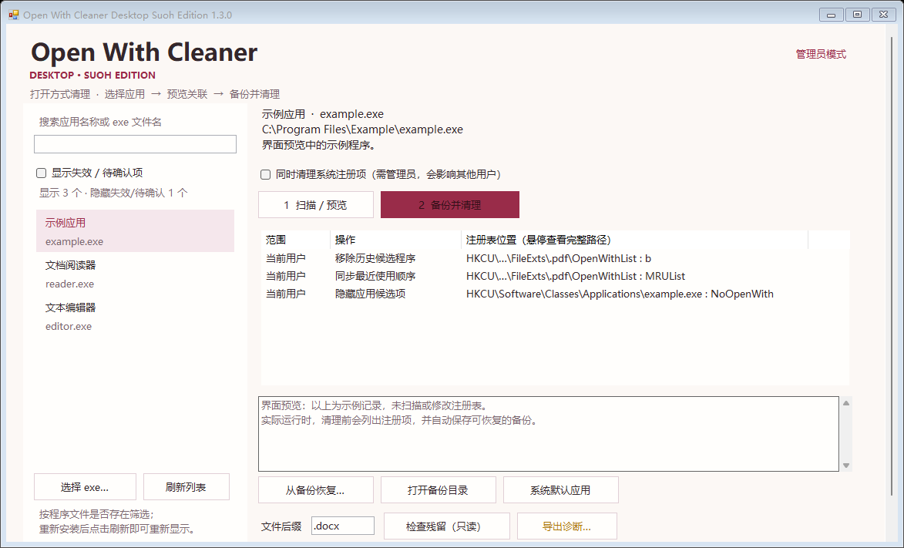

# Open With Cleaner Desktop Suoh Edition

一个带有苏芳配色的 Windows「打开方式」管理工具。选择桌面应用，预览它的文件关联候选，备份后清理，并在需要时恢复。

**[下载 Windows v1.3.0 便携版](https://github.com/575610871/open-with-cleaner-desktop/releases/tag/v1.3.0)**

**macOS 版：** 原生 SwiftUI 版本位于 [macos/](macos/README.md)，使用相同苏芳配色。它检查 Launch Services 的应用记录，只定向注销确认失效的本地路径。Mac 版保存操作记录，不提供 Windows 版的注册表备份恢复；两个平台分别构建与编号。



## 功能

- 搜索应用名称或 EXE 文件名，或手动选择程序。
- 默认显示能找到实际程序文件的已注册应用；失效或无法确认的旧记录可单独查看。
- 每次刷新重新检查程序文件，重新安装后可以再次显示，没有永久隐藏名单。
- 预览传统桌面应用的 `OpenWithList`、`OpenWithProgids` 和相关隐藏标记。
- 在修改前保存逐项备份，保留数据类型与修改前后的状态。
- 恢复时检查冲突，避免覆盖其他软件后续作出的不同修改。
- 保护当前默认应用；需要更换默认时，通过 Windows 设置完成。
- 提供只读残留诊断，检查应用路径、图标位置和 Windows Shell 的关联候选。
- 普通用户范围与需要管理员权限的系统范围分别处理。

## 下载与使用

1. 从 [Releases](https://github.com/575610871/open-with-cleaner-desktop/releases) 下载 `open-with-cleaner-desktop-suoh-edition-1.3.0-win-portable.zip`。
2. 完整解压，运行 **Open With Cleaner Desktop Suoh Edition.exe**。
3. 搜索并选中应用，点击「扫描 / 预览」。
4. 核对修改范围后点击「备份并清理」。
5. 如应用仍是某些文件类型的默认应用，先点击「系统默认应用」更换，再重新扫描。

适用于 Windows 10 / 11，使用系统的 .NET Framework 4 系列运行环境。当前构建为 AnyCPU；不需要安装 Python、Node.js 或 .NET SDK。

清理文件关联候选不会卸载应用。程序文件仍然存在时，该应用仍会显示在本工具列表中；已卸载、已移动或失效的路径默认隐藏。重新安装后点击「刷新列表」或重新打开工具即可重新检测。

## 备份与恢复

备份位置：

```text
%LOCALAPPDATA%\OpenWithCleaner\Backups
```

点击「从备份恢复…」选择本工具生成的 XML 备份。旧版备份仍然兼容。备份与原 Windows 用户和计算机绑定；恢复仅回退仍与本工具写入状态一致的项目。

「同时清理系统注册项」需要管理员权限，会影响其他用户。使用另一个管理员账户提权时，当前用户范围和备份位置也会切换。

## 只读诊断

填写实际文件后缀（例如 `.xlsx`），点击「检查残留（只读）」。报告会列出程序路径、关联候选、原始默认选择记录及可读取的注册来源。

原始 `UserChoice` 数据不一定等同于 Windows 最终采用的有效默认；报告会标出数据来源。Shell 枚举也不保证与所有 Windows 11 版本的选择器完全一致。

应用不会自动上传本机报告或备份。手动导出的诊断可能包含程序路径，备份包含本机身份信息，请在自行分享前检查内容。

## 处理范围

主要面向传统桌面程序的关联记录。工具不改写 `UserChoice` / `Hash`，不删除整个应用或 ProgID 注册项。

AppX / UWP / MSIX、动态处理程序及软件更新后的重新注册可能继续提供候选。无法确认归属、读取失败或存在冲突的项目会保留并提示。同名 EXE 的不同安装版本可能共用候选记录。`NoOpenWith` 还可能影响应用的跳转列表记录。

## 从源码构建

源码位于 `src/`，不使用 NuGet 或第三方运行库。Windows 自带的 .NET Framework C# 编译器即可构建：

```powershell
powershell -NoProfile -ExecutionPolicy Bypass -File .\src\build.ps1 -OutputDirectory .\build
```

输出文件：

```text
build\Open With Cleaner Desktop Suoh Edition.exe
```

## 测试

```powershell
powershell -NoProfile -ExecutionPolicy Bypass -File .\src\test.ps1
powershell -NoProfile -ExecutionPolicy Bypass -File .\src\test-diagnostics.ps1
powershell -NoProfile -ExecutionPolicy Bypass -File .\src\test-catalog.ps1
powershell -NoProfile -ExecutionPolicy Bypass -File .\src\test-ui.ps1
```

当前包含 27 项清理引擎测试、7 项诊断测试、27 项程序可用性测试和 4 项界面过滤测试。测试使用内存注册表和临时文件，不修改真实文件关联。

## 外观

- 苏芳主色：`#992C49`
- 暖白底色与浅苏芳选中背景
- 产品名称：**Open With Cleaner Desktop Suoh Edition**

## 技术资料

- [Windows 应用注册](https://learn.microsoft.com/en-us/windows/win32/shell/app-registration)
- [Windows 默认应用平台](https://learn.microsoft.com/en-us/windows/apps/develop/windows-integration/default-apps-platform)
- [Windows Shell 关联枚举](https://learn.microsoft.com/en-us/windows/win32/api/shobjidl_core/nf-shobjidl_core-shassocenumhandlers)
